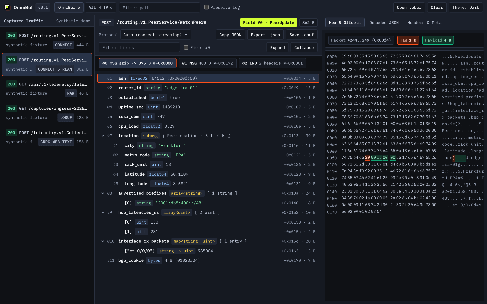
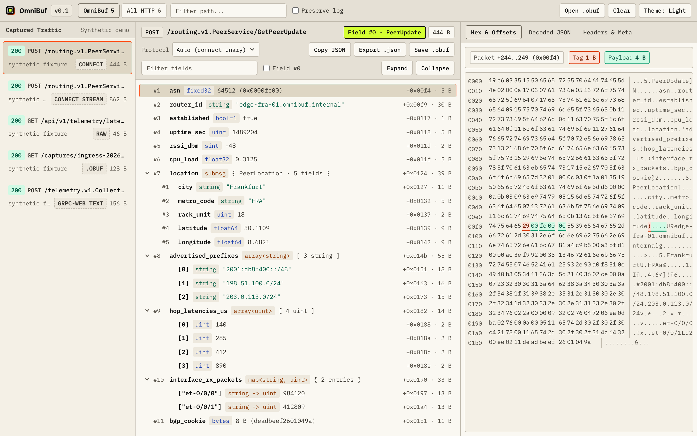
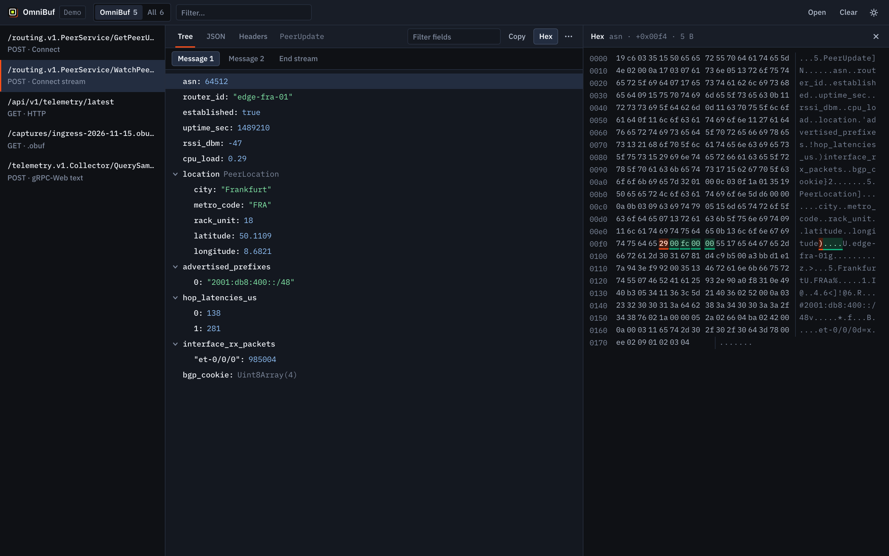
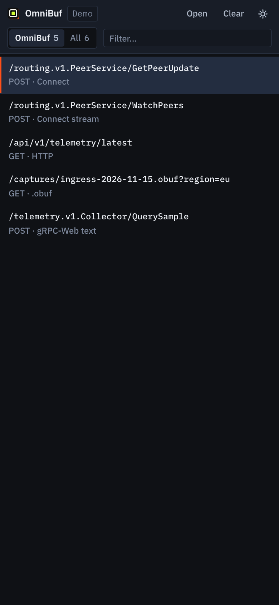
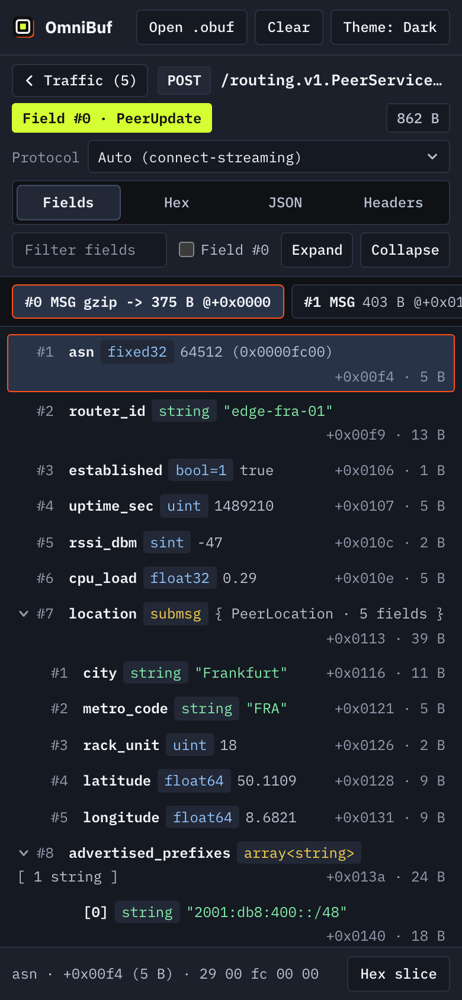
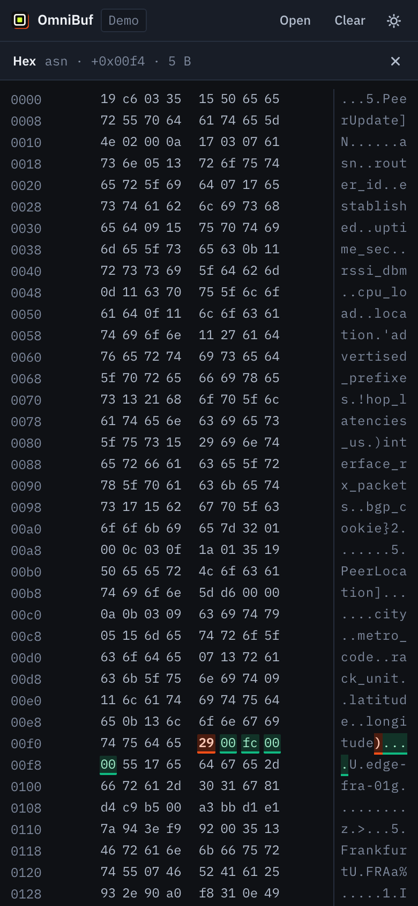

# OmniBuf DevTools (`omnibuf-devtools`)

[](https://omnibuf.com/spec)
[](./LICENSE)
[](https://omnibuf.com)

Manifest V3 browser Developer Tools extension for inspecting **[OmniBuf v0.1](https://omnibuf.com/spec)** HTTP responses, ConnectRPC unary and server-streaming calls, gRPC-Web streams, and local `.obuf` capture files. Built on [`@omnibuf/core`](https://github.com/omnibuf/omnibuf-es/tree/main/packages/omnibuf) and [`@omnibuf/web`](https://github.com/omnibuf/omnibuf-es/tree/main/packages/omnibuf-web).



|                              Light Theme                              |                           Optional Hex Side Panel                           |
| :-------------------------------------------------------------------: | :-------------------------------------------------------------------------: |
|  |  |

|                     Narrow Dock: Requests                     |                  Narrow Dock: Field Tree                   |                  Narrow Dock: Optional Hex                   |
| :-----------------------------------------------------------: | :--------------------------------------------------------: | :----------------------------------------------------------: |
|  |  |  |

---

## Architecture

Three explicit layers separate network capture, transport framing, and wire decoding:

```text
Browser network capture (chrome.devtools.network getContent())
        ↓
Protocol adapter: framing, compression, trailers
        ↓
OmniBuf decoder: expandable field tree + byte offsets + JSON export
```

| Transport / Protocol        | Media Types & Triggers                                                                           | Adapter Behavior                                                                                                                                                                                       |
| :-------------------------- | :----------------------------------------------------------------------------------------------- | :----------------------------------------------------------------------------------------------------------------------------------------------------------------------------------------------------- |
| Plain HTTP / REST & `.obuf` | `application/omnibuf`, `application/x-omnibuf`, `application/vnd.omnibuf`, `*.obuf`, `*.obuf.gz` | Decodes the response body directly (decompressing `.obuf.gz` payloads via `DecompressionStream`).                                                                                                      |
| ConnectRPC Unary            | `application/omnibuf` with `Connect-Protocol-Version` or `Connect-Content-Encoding`              | Extracts the single message payload, handles `gzip` / `deflate` encoding, and surfaces Connect JSON error bodies on failed unary calls.                                                                |
| ConnectRPC Streaming        | `application/connect+omnibuf`, `application/connect+x-omnibuf`                                   | Splits 5-byte `[flags: u8, length: u32 BE]` envelopes, decompresses per-envelope `gzip` / `deflate` payloads (`flags & 0x01`), and separates `EndStreamResponse` metadata/error JSON (`flags & 0x02`). |
| gRPC-Web & gRPC-Web Text    | `application/grpc-web+omnibuf`, `application/grpc-web-text+omnibuf`                              | Decodes binary or multi-segment base64 frames, decompresses `grpc-encoding` frames, and parses `0x80` trailer blocks (`grpc-status`, `grpc-message`).                                                  |

Ordinary Protobuf traffic (`application/proto`, `application/grpc-web+proto`) is not OmniBuf. Endpoints must serialize messages with an OmniBuf codec. Any untagged binary response (`application/octet-stream`) can be inspected on demand by switching the capture scope to **All HTTP** and clicking **Decode as OmniBuf**.

---

## Capabilities

- **Zero-schema wire inspection:** OmniBuf encodes 16 explicit wire types (`0..15`) in the low nibble of every field tag. Schema-less responses render as numbered fields (`field_1`, `field_2`) with exact scalar, array, map, and sub-message structure.
- **Inline `Field #0` `SchemaMeta` resolution:** Self-describing packets automatically populate `.proto` field names and message type names across root and nested sub-messages.
- **Hover wire metadata & optional hex panel:** Field rows stay clean as `key: value` pairs at rest, revealing `#field · wireType · byteLength · hex` on hover. Toggling **Hex** opens a synchronized 16-byte hex + ASCII side panel with color-coded tag, header, and payload spans.
- **Lossless 64-bit JSON export:** Copy or download decoded JSON directly from the panel; 64-bit integers beyond `Number.MAX_SAFE_INTEGER` serialize as exact decimal strings.
- **Zero host permissions:** Captures completed responses strictly via `chrome.devtools.network` and local `.obuf` drag-and-drop.

---

## Build & Load Unpacked

```bash
# Install dependencies and build dist/
just install
just build

# Package Chrome, Firefox, and Mozilla AMO source zips into artifacts/
just pack

# Generate 1280x800 24-bit RGB store listing screenshots into artifacts/store-screenshots/
just store-screenshots
```

### Chrome / Edge / Brave / Chromium

1. Open `chrome://extensions` and enable **Developer mode**.
2. Click **Load unpacked** and select `omnibuf-devtools/dist`.
3. Open Developer Tools (`Cmd+Opt+I` / `F12`) and select the **OmniBuf** tab.

### Firefox

1. Open `about:debugging#/runtime/this-firefox`.
2. Click **Load Temporary Add-on...** and select `omnibuf-devtools/dist/manifest.json`.
3. Open Web Developer Tools and select the **OmniBuf** panel.

---

## Development & CI

```bash
just test               # Run Layer 1, Layer 2, Layer 3, and packaging tests
just lint               # ESLint + strict TypeScript typecheck
just fmt-check          # Prettier format verification
just screenshots        # Regenerate docs/screenshots/*.png via headless Chrome
just store-screenshots  # Generate 1280x800 24-bit RGB store screenshots
just ci                 # Full check (fmt-check, lint, build, test)
```

## License

Released under the [Apache 2.0 License](./LICENSE).
